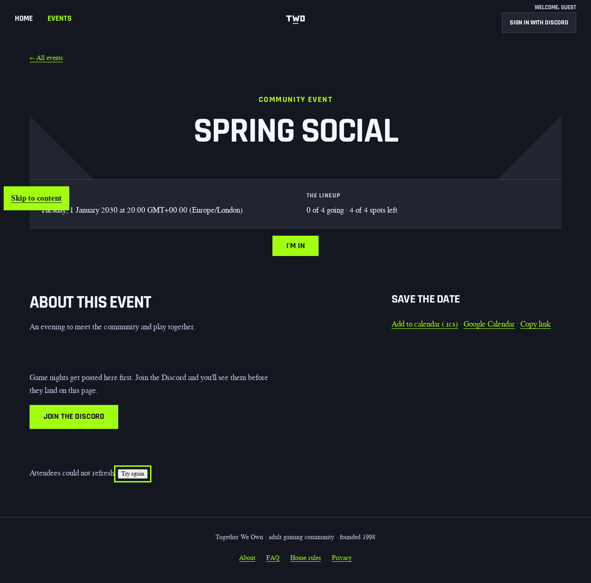
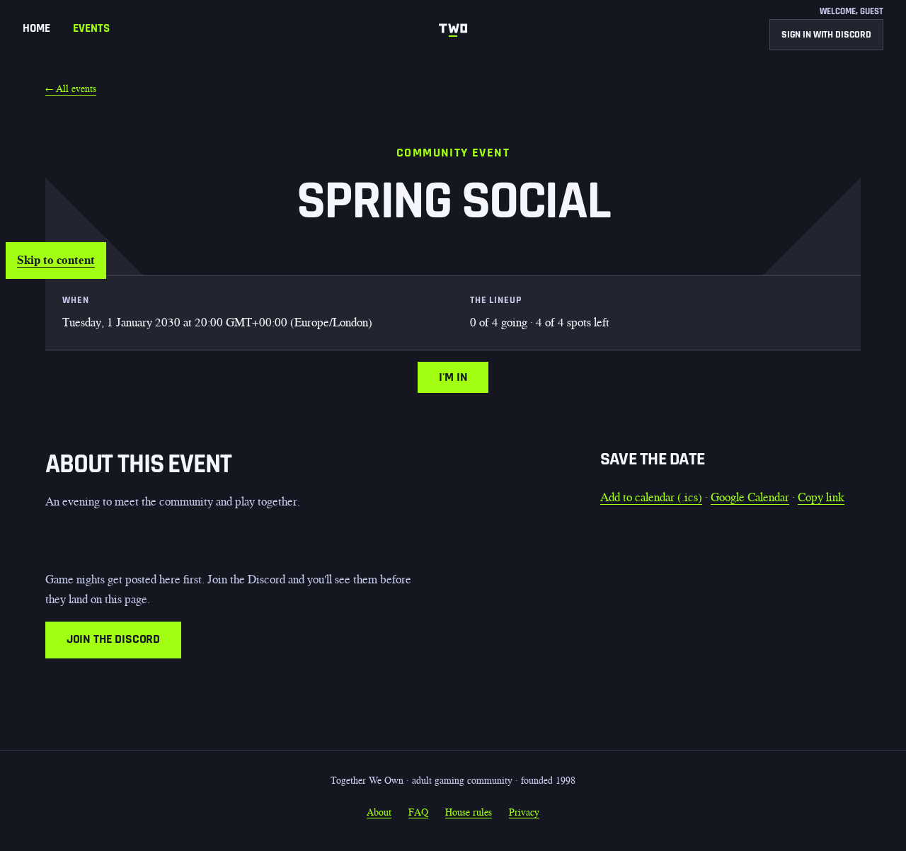
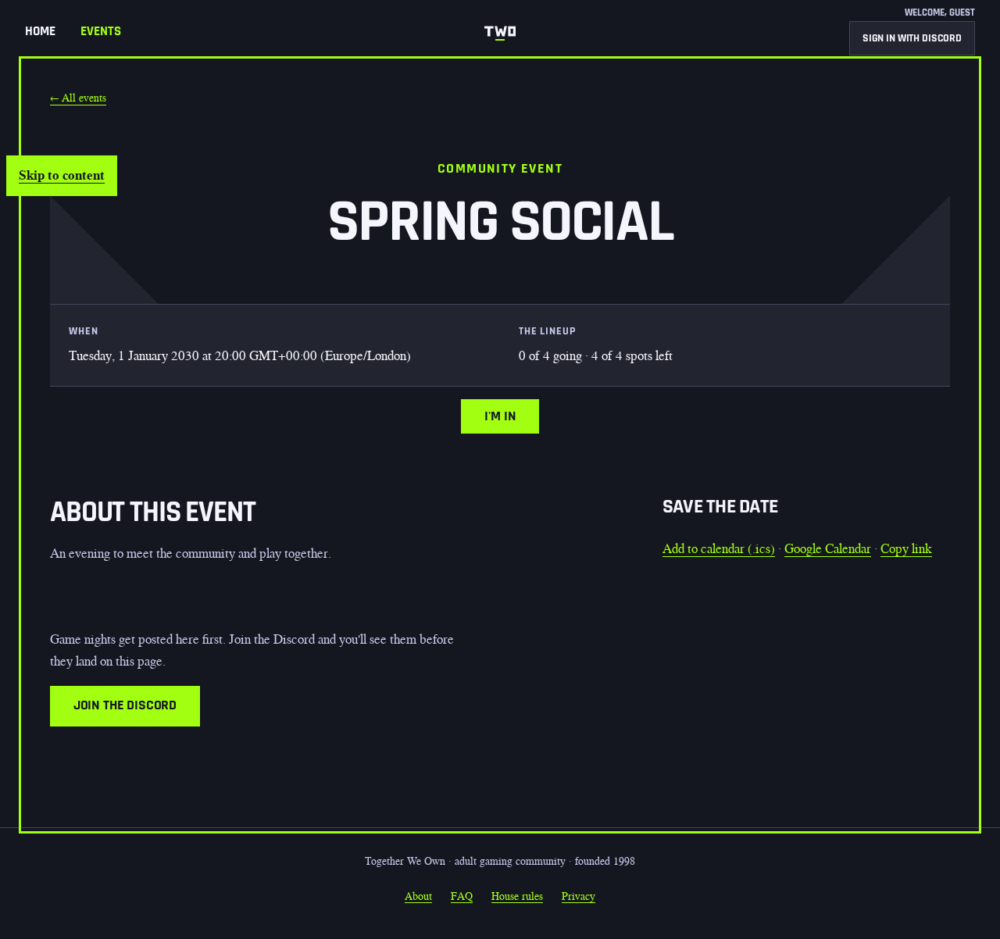
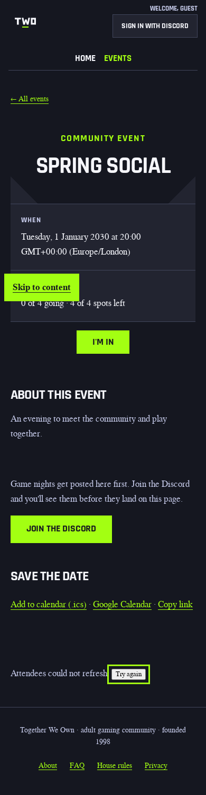
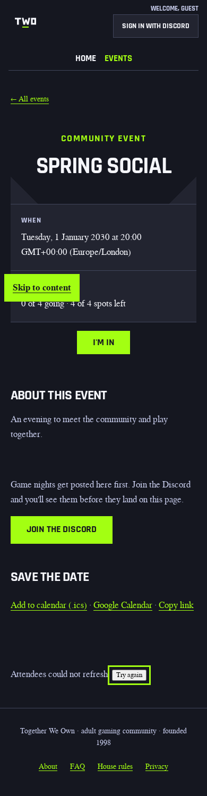
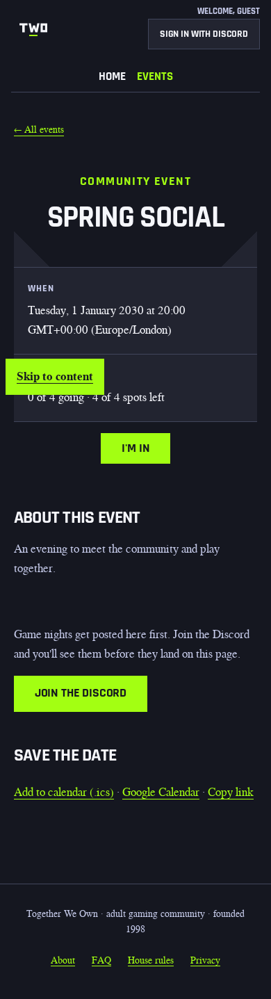
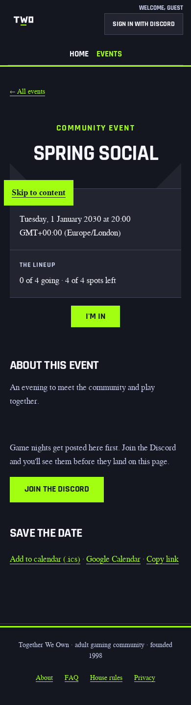

# Attendee recovery focus evidence

## Behavior-restoration design contract

Audience: keyboard and assistive-technology users retrying an event's attendee
refresh. The screen's job is to recover the existing roster read without losing
the user's place. The primary action remains **Try again**.

The references are the island's existing `focusedInside` helper, its
heading-focus behavior after insertion/replacement, and its main-region fallback
after roster removal in `assets/islands/attendees-live.js`. The event shell
already renders a focusable main region. There is no new visual direction.

Keep the real content, layout, typography, tokens and responsive behavior. The
fixture uses a fictional Spring social event, zero attendees, the existing stale
notice and the existing button. Required states are stale, pending, recovered
empty, moved-away focus, populated insertion/replacement/removal, and rejected or
superseded responses. No copy, roster markup, requests, polling, admission rules
or bundle-budget changes are in scope.

## Executed keyboard proof

A DB-free loopback server rendered the real Hono `EventPage` with an empty
page-one roster and served the actual styles, fonts and scripts from `public/`.
Chromium blocked off-origin traffic. No live RSVP or database writes occurred.
The header remained in its default guest state; the event body used the member
fixture to expose the same island mounts as the acceptance suites.

For both widths, the first two attendee fragment reads returned 503, exhausting
the existing automatic retry. Keyboard Tab traversal reached the standalone
**Try again** button; Enter issued the third read. That read returned the real
same-event, empty `EventPage` HTML. The stale note disappeared in both versions.
Native `document.activeElement` showed the difference:

| Version | Viewport | Focus after recovery | Fragment reads |
| --- | --- | --- | --- |
| Before | 1280×800 | `BODY` | 3 |
| Before | 390×844 | `BODY` | 3 |
| After | 1280×800 | `MAIN#main` | 3 |
| After | 390×844 | `MAIN#main` | 3 |

A separate after-change control activated retry, pressed Tab while the third
read was pending, and then released the response. Focus stayed on the same
existing link rather than moving to main.

The screenshots below were captured at the stated viewport sizes with full-page
capture, so their image heights exceed the viewport. All eight were opened and
visually reviewed. The recovered main focus outline is expected; there is no
layout or copy change and no existing visual baseline was updated.

## Desktop screenshots

| State | Before | After |
| --- | --- | --- |
| Stale, retry focused |  |  |
| Empty recovery |  |  |

## Mobile screenshots

| State | Before | After |
| --- | --- | --- |
| Stale, retry focused |  |  |
| Empty recovery |  |  |

## Regression scope

The new builder-owned `test/event-attendees-recovery-focus.test.ts` executes the
shipped minified island against a minimal DOM boundary double. It first failed
with body instead of main; its other seven controls already passed. All eight
pass with the correction. The controls cover moved-away focus, populated
insertion/replacement, roster removal, failed/foreign documents, and superseded
responses. The existing acceptance-author files remain unchanged.

The independent browser proof above covers native focus removal and actual SSR
markup, which the DOM double cannot establish. Existing attendee admission,
retry-fencing, live-refresh, attendee-page and Kit-island suites cover the
adjacent contracts. General Hono a11y and Lighthouse fixtures do not themselves
exercise this stale-retry interaction. The standard visual comparisons run on
the pinned CI runner, not this local fixture. This evidence does not claim a
Kit-route browser test or a staging/production deployment.

## Normal check outcome

`npm run check` exited 1 on a fresh disposable test database: **14,798 passed,
6 failed, 161 skipped**. The six failures were all in the unchanged
`test/workflow-migration-auth.test.ts`, at the synthetic authenticated fetch:

| Workflow | Failing baseline case |
| --- | --- |
| `ci.yml` | `pull_request` |
| `ci.yml` | `push` |
| `ci.yml` | `workflow_dispatch` |
| `ci.yml` | `.git`-suffixed origin |
| `db-migrate.yml` | `workflow_dispatch` |
| `db-migrate.yml` | `.git`-suffixed origin |

Each reported `migration-history: cannot read Git baseline (fetch)`. The managed
Git launcher does not forward the fixture's process-scoped synthetic authorization
header. The fixture, related tests, workflows and migration checker scripts are
byte-identical to the execution base. No real token was supplied, no launcher was
bypassed, and no test or gate was weakened. Exact-head CI is still required.

The chain's later steps were executed independently and passed: the a11y-policy
and visual-accept unit tests (76), cutover selftests (20), shadow selftests (5),
bundle-budget selftests and asset budgets, performance-gate selftests, smoke tests
(332), and E2E safety tests (99). This does not turn the full check green.

## Local audit scope

`npm run a11y` passed 146 page/state/viewport cases with zero violations at
360×780 and 1280×900. Its exact exercised paths and identities are listed in
[audit routes](evidence/attendee-recovery-focus/a11y-routes.md). Those are local
Hono fixtures, including public, member, moderator and error states, not live
routes or the stale-retry sequence.

The Lighthouse fixture configuration covers `/`, `/events`,
`/e/01ARZ3NDEKTSV4RRFFQ69G5FAV`, `/join`, `/about`, `/faq`, `/rules`, and `/privacy`.
Mobile performance and desktop quality each collected three runs per route.
`npm run lighthouse` and `npm run lighthouse:quality` both exited 1 after full
collection because process-tree cleanup could not spawn the unavailable `ps`.
The separate, unmodified commands `npx lhci assert --config=ci/lighthouserc.cjs`
and `npx lhci assert --config=ci/lighthouserc.quality.cjs` each passed all 24 reports.
This is assertion evidence, not a claim that either autorun was green. No shim,
threshold relaxation or audit skip was used. Neither fixture represents
signed-in attendee recovery.
