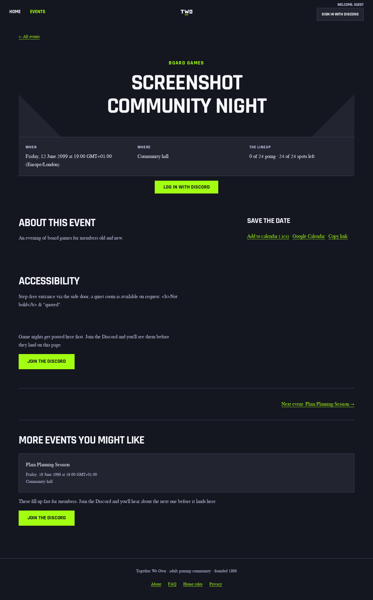
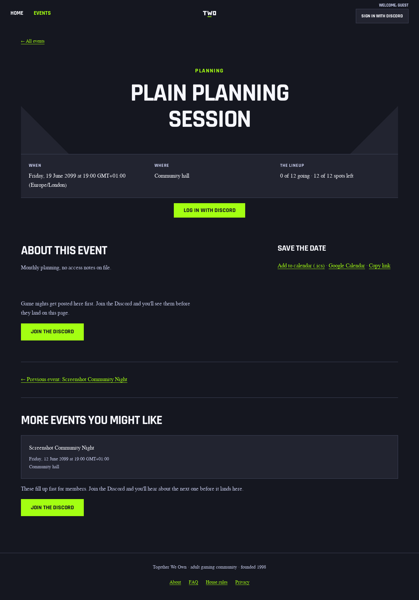

# Event accessibility notes evidence

## Design contract

Audience: members deciding whether and how to attend an event, and moderators
recording confirmed access arrangements. The event page's job is to show
organizer-entered access notes where attendees already look; the moderator
form's job is to accept short plain-text notes without implying any
accommodation promise. The primary attendee action stays RSVP; there is no new
call to action.

References: the existing `event-description` section (same heading/body
typography and spacing), the description textarea in
`src/admin/pages/event-form-fields.tsx` (same field stack, same
`data-event-text-limit` client convention), and the 1,000-character bound
already used for descriptions. No new visual direction.

Layout: the notes render as an `Accessibility` section directly after the
event description on the detail page, reusing the description section's class
so desktop and mobile inherit the current grid without new CSS. Typography,
tokens and responsive behavior are unchanged. Required states: notes present
(section shown, markup escaped), blank or legacy null (section omitted, page
byte-identical apart from the field's absence). Non-goals: generated
accommodation claims, contact collection, a publish gate, JSON/feed/sitemap
exposure, and any change to description rendering.

## Executed browser proof

A local `wrangler dev` worker served the real app against a disposable,
migrated run-owned Postgres database holding two fictional published events:
one with notes (`Step-free entrance via the side door; a quiet room is
available on request. <b>Not bold</b> & "quoted".`) and one with a null value.
Chromium rendered each event as a guest at 1280x800 and 390x844. All four
full-page screenshots below were opened.

| State | Desktop | Mobile |
| --- | --- | --- |
| With notes |  |  |
| No notes |  |  |

Observed: the `Accessibility` heading follows `About this event` at both
widths; the `<b>` probe renders as literal text (escaped, not bold); the
no-notes page shows no Accessibility section and keeps the existing layout.
The moderator create/edit control is proved by the DB-backed acceptance suite
(`test/event-accessibility-notes-admin-acceptance.test.ts`, 4/4), which reads
the rendered textarea value back after create and edit.

## Gate results

- `npm run a11y`: 146 local Hono page/state/viewport cases passed, zero
  violations, including guest/member/moderator event-detail pages at 360px and
  1280px (200, 410 and 404 states).
- Targeted axe-core scan (wcag2a + wcag2aa) of the with-notes event page at
  1280x800: 0 violations.
- `npm run lighthouse` (mobile): 24 reports across the eight fixture routes,
  all configured assertions passed via `npx lhci assert`. The autorun wrapper
  exits 1 during cleanup (`spawn ps ENOENT`: the container has no `ps`), after
  collection completes; thresholds unchanged.
- `npm run lighthouse:quality` (desktop): 24 reports across the eight fixture
  routes, all quality-floor assertions passed via `npx lhci assert`, with the
  same environmental cleanup failure and unchanged floors.
- Visual baselines: the seeded visual-spec event carries no notes, so the
  committed `event` baselines are unaffected. Comparisons run in CI on the
  pinned runner; no baseline changes are expected from this slice.
