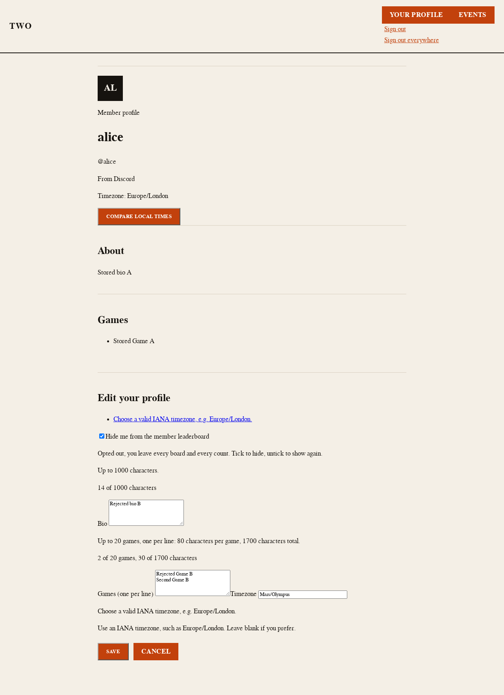
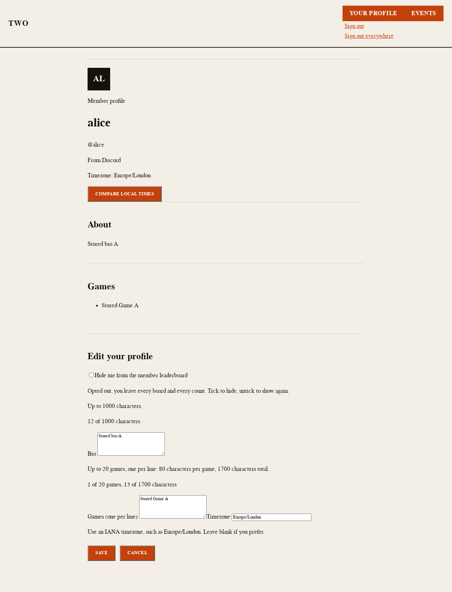

# Refused-draft Cancel without JavaScript — visual evidence

Synthetic fixture member only: stored profile A (bio "Stored bio A", one game,
Europe/London, on the leaderboard) and rejected draft B (bio "Rejected bio B",
two games, checked opt-out; timezone Mars/Olympus for 422, Asia/Tokyo with a
failing store for 503). Captures use the real Hono profile routes, the real
server-rendered page, shipped public styles, in-memory stores, an ephemeral
loopback server, and Chromium with JavaScript disabled. No staging or
production probe was used. Before = pre-fix tree (native `type="reset"`
Cancel); after = this change (safe same-profile GET link on refusal pages).

## Design contract

- **Audience/job:** a member without JavaScript whose profile save was refused
  presses Cancel to abandon the bad draft. The primary action stays Cancel;
  the job is discarding B and showing the saved profile A.
- **Content:** the refused 422 and 503 editor states with draft B in the
  controls, then the post-Cancel state for each.
- **Continuity references:** the existing profile editor
  ([pages](../../../src/profiles/pages.tsx)), the member-profile island
  contract ([contracts](../../../src/islands/contracts-member-profile.ts)),
  and the [refused-draft recovery](../profile-refused-draft-recovery/)
  captures.
- **Layout, typography and tokens:** unchanged. Cancel keeps
  `class="btn profile-secondary"` and the same copy, position and size; no
  stylesheet or token change.
- **Responsive behavior:** full scrollable pages at desktop 1280x800 and
  mobile 390x844. The mobile header overlap is pre-existing and identical
  in every shot.
- **States:** 422 refusal, 503 refusal, and post-Cancel for each status at
  both widths. Ordinary GET editors and the JS-enabled in-place reset are
  unchanged and covered by the existing suites.
- **Non-goals:** restyle, validation-rule or refusal-status changes,
  cache-header changes, new visual baselines, route activation or deployment.

## Opened before/after captures

Each capture self-asserted its state before shooting (B in the controls on
refusal; B retained before the fix vs A restored and the error gone after).
Cancel was activated synthetically so no focus ring or skip-link chrome
appears; a real keyboard press focuses Cancel normally.

| State | Viewport | Before | After |
| --- | --- | --- | --- |
| 422 refusal | Desktop 1280x800 | [Before](refusal-422-desktop-before.png) | [After](refusal-422-desktop-after.png) |
| 422 refusal | Mobile 390x844 | [Before](refusal-422-mobile-before.png) | [After](refusal-422-mobile-after.png) |
| 503 refusal | Desktop 1280x800 | [Before](refusal-503-desktop-before.png) | [After](refusal-503-desktop-after.png) |
| 503 refusal | Mobile 390x844 | [Before](refusal-503-mobile-before.png) | [After](refusal-503-mobile-after.png) |
| After Cancel (was 422) | Desktop 1280x800 | [Before](cancelled-422-desktop-before.png) | [After](cancelled-422-desktop-after.png) |
| After Cancel (was 422) | Mobile 390x844 | [Before](cancelled-422-mobile-before.png) | [After](cancelled-422-mobile-after.png) |
| After Cancel (was 503) | Desktop 1280x800 | [Before](cancelled-503-desktop-before.png) | [After](cancelled-503-desktop-after.png) |
| After Cancel (was 503) | Mobile 390x844 | [Before](cancelled-503-mobile-before.png) | [After](cancelled-503-mobile-after.png) |

Refusal before/after pairs differ in one sub-control detail: as an anchor,
Cancel renders without the native button outset border. Everything else on
the refusal pages is unchanged. Post-Cancel pairs differ by design: before
keeps draft B with the error summary and B-seeded counts; after shows the
saved profile A with matching counts and no error. The after-cancel landing
page is the ordinary editor, where Cancel is again `type="reset"`.

