# RSVP soft-answer event page: visual evidence

Stored `maybe`/`not_going` answers render a neutral `role=status` line instead of
the join CTA on both event-page twins. Every image below was opened by the author.

## Design contract

- Audience: signed-in members who answered Maybe/Can't-go on an event.
- Screen job: the event detail RSVP block names their stored answer; the primary
  action becomes change (open/full) or withdraw (all states).
- References: the existing going-confirmed and waitlisted branches in the same
  block (same withdraw pattern, same buttons, no new CSS). Assumption: no new
  visual direction.
- Layout/typography/tokens: unchanged; the soft line and buttons reuse the
  established RSVP block styles on both twins.
- Responsive: native form stacks like the existing branches; verified at
  1280x800 and 390x844.
- Required states: maybe/not-going x open/paused/full x Hono/Kit (16 shots).
- Non-goals: new answer types, write/throttle/seat/waitlist policy, sync
  mirroring, new CSS.

## Method

Real Hono route HTML via `app.request` against a schema-scoped disposable
fixture on agent-testdb (seeded member + events + RSVP rows, memory session),
and the real Kit production resolver plus compiled Svelte SSR for the same
seeded rows. Kit shots link the production stylesheets (`styles.css`,
`theme.css`, `event-theme.css`) plus the built Kit app CSS. Screenshots taken
with Chromium after 1.5s settle, JavaScript on: zero page errors, the soft
line present in every shot, and no bare join CTA flash (SSR carries the line).

## Hono

| State | Desktop | Mobile |
| --- | --- | --- |
| maybe, open | 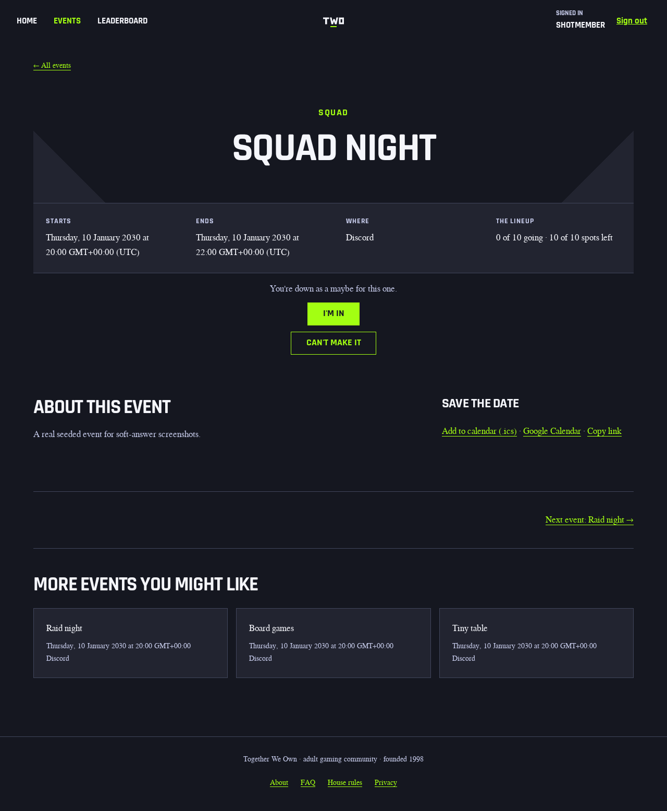 | 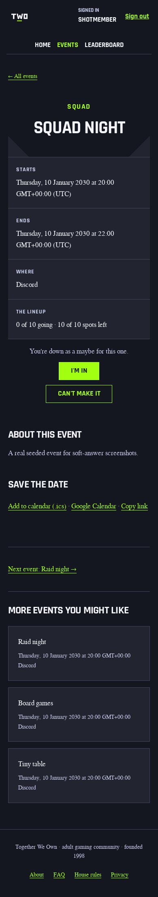 |
| not-going, open | 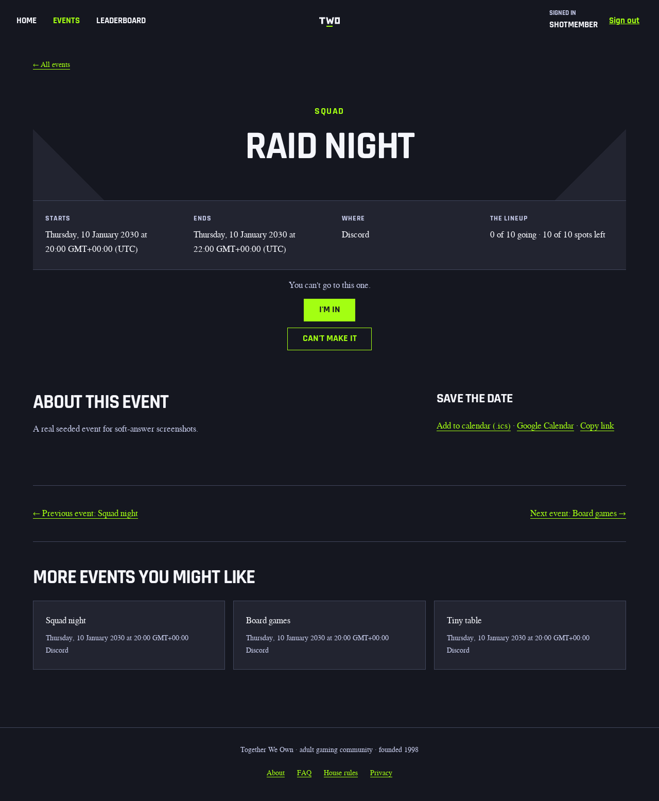 | 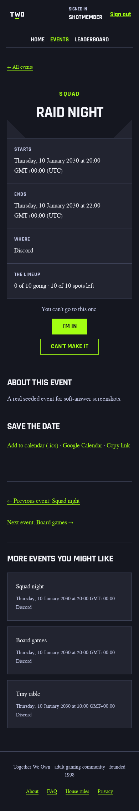 |
| maybe, paused | 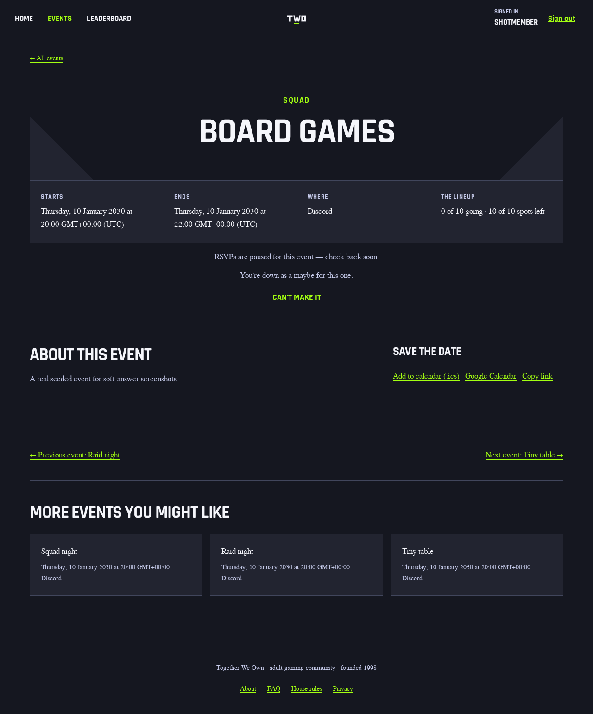 | 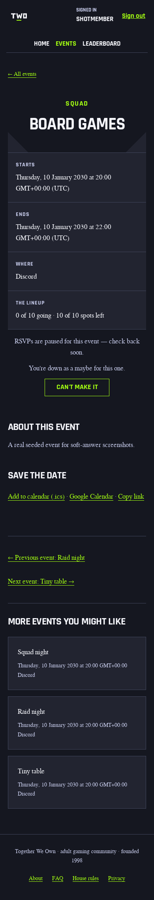 |
| maybe, full | 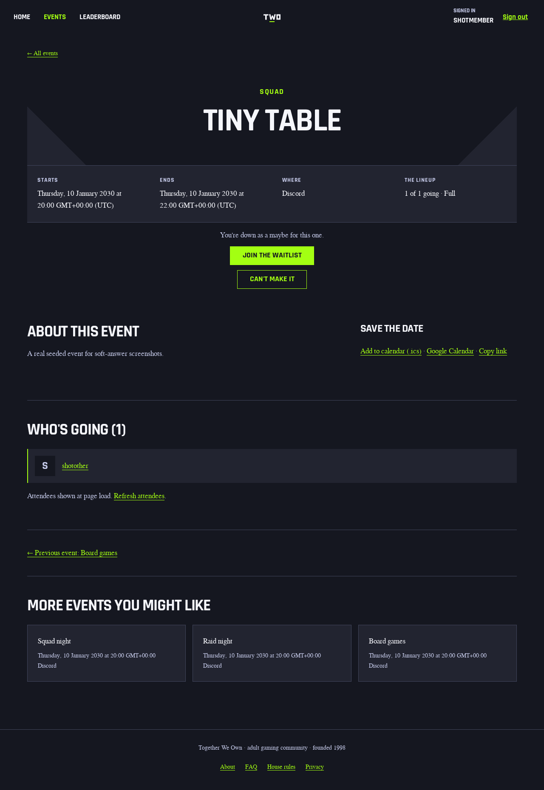 | 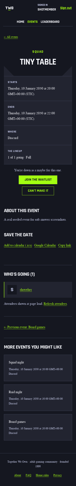 |

Open states show the answer line with I'M IN + CAN'T MAKE IT. Paused shows the
paused notice with the answer line and withdraw only. Full shows the answer
line with JOIN THE WAITLIST + CAN'T MAKE IT and no full notice.

## Kit

| State | Desktop | Mobile |
| --- | --- | --- |
| maybe, open | 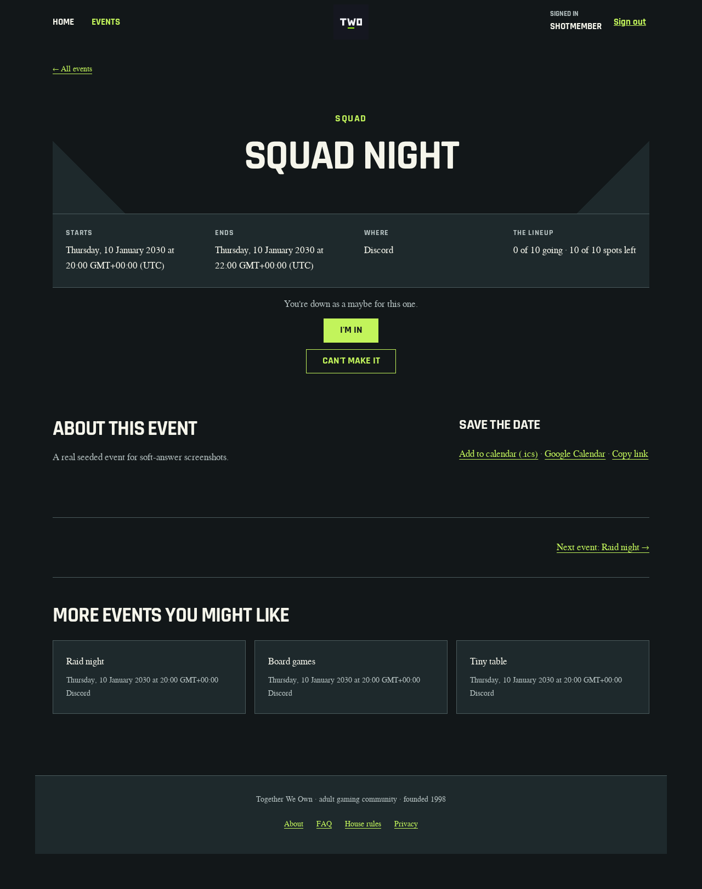 | 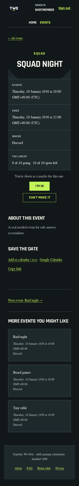 |
| not-going, open | 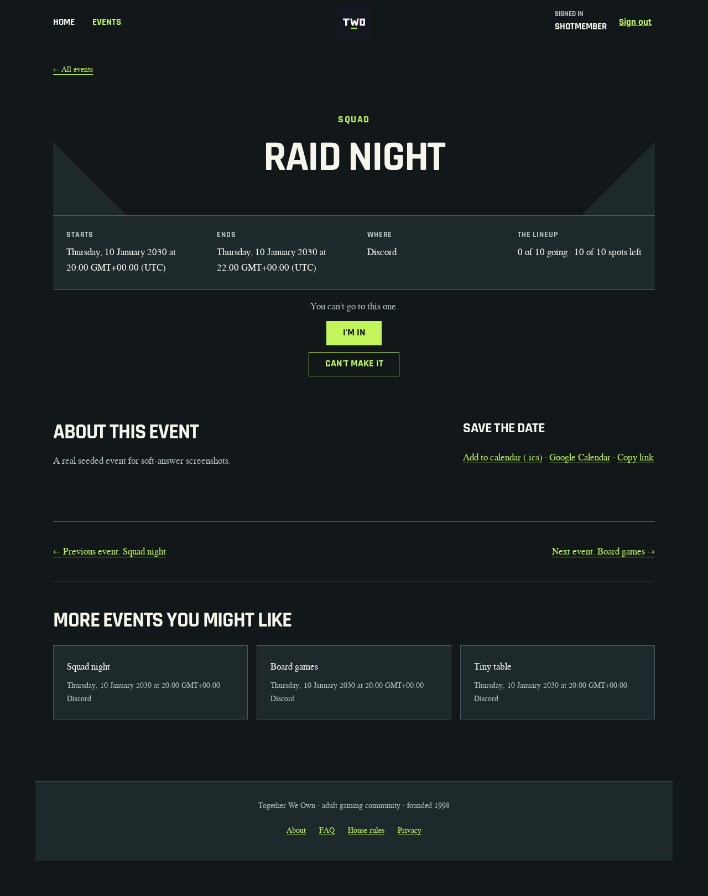 | 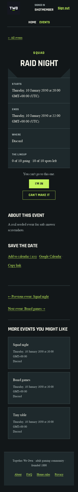 |
| maybe, paused | 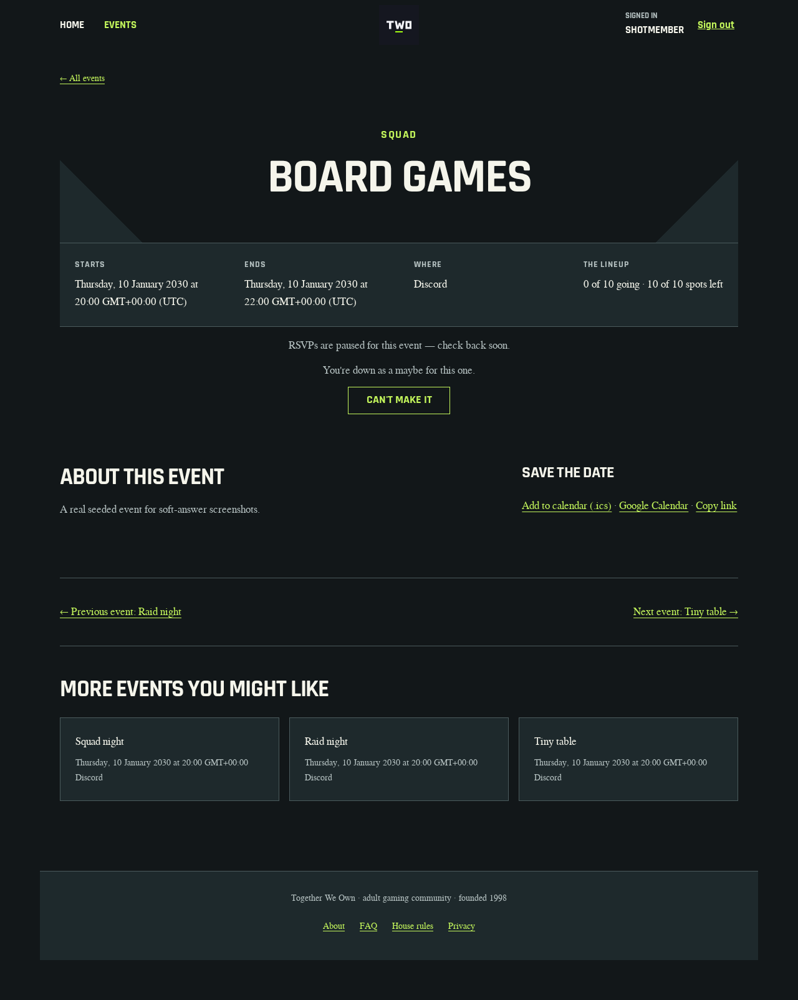 | 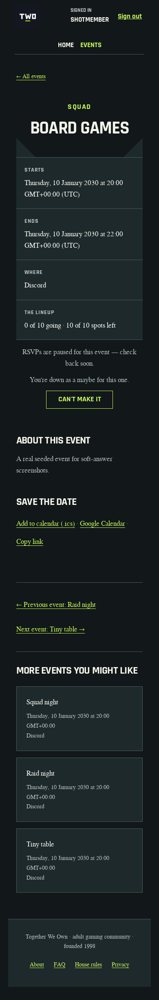 |
| maybe, full | 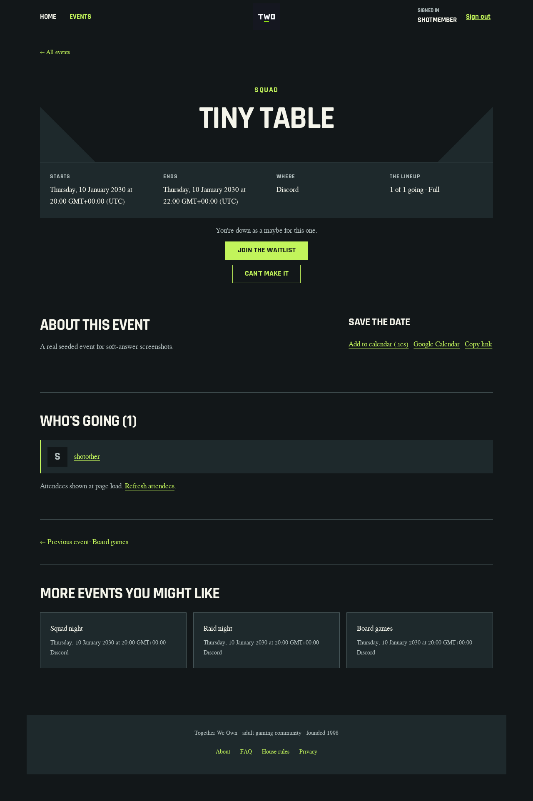 | 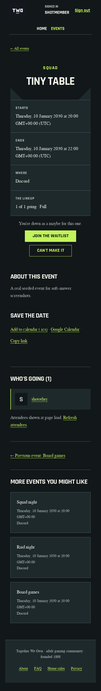 |

Same four states, same controls, same copy as Hono.
