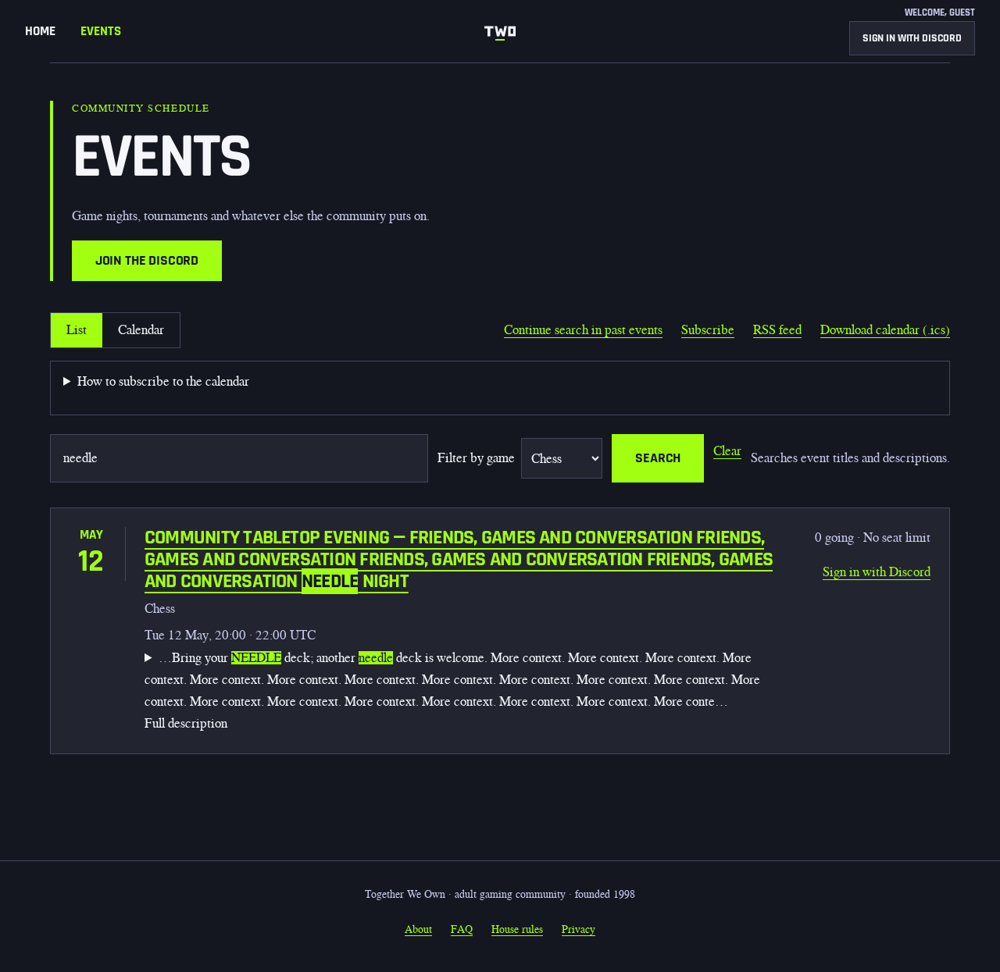
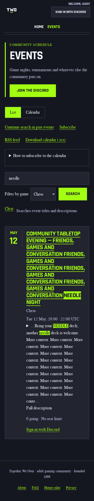

# Upcoming search match context — visual evidence

These are synthetic fixture events, not a live schedule. Captures use the real
Hono schedule route, mocked database reads, shipped public styles and islands,
and Chromium. The Kit adapter uses that same schedule renderer; the independent
browser suite exercises both adapters. No staging or production probe was used.

## Design contract

- **Audience/job:** members and guests should see why a returned night matches
  before opening it. The primary action remains its complete native title link.
- **Content:** a long community-night title with `NEEDLE` and a description whose
  relevant sentence occurs after thirty unrelated introductory sentences.
- **Continuity references:** [existing schedule card](../../../src/events/pages-calendar-card.tsx),
  [archive match presentation](../../../src/events/pages-past.tsx), and the
  [shared literal segment helper](../../../src/events/search-context.ts).
- **Layout, typography and tokens:** retain the existing date/info/actions layout,
  fonts and semantic-mark colors. One inline title wrapper preserves wrapping
  inside the theme's flex anchor. No stylesheet or client-island change.
- **Responsive behavior:** complete titles wrap at desktop 1280×800 and mobile
  390×844 viewports; the screenshots include the full scrollable page. Description
  passages stay within 320 Unicode code points, including ellipses.
- **States:** blank text retains the ordinary 240-code-point excerpt; a search
  uses literal marked title/passage segments. Unlocatable SQL-admitted matches
  retain an honest unmarked excerpt. Full description remains native, original
  and readable without JavaScript. Existing failure, cancellation and transient
  actions remain unchanged.
- **Non-goals:** redesign, SQL/ranking/read changes, archive features, new client
  matching, budget changes, route activation or deployment.

## Opened before/after captures

| Viewport | Before | After |
| --- | --- | --- |
| Desktop 1280×800 | [Before](before-desktop.png) | [After](after-desktop.png) |
| Mobile 390×844 | [Before](before-mobile.png) | [After](after-mobile.png) |





The relevant sentence now appears before opening Full description. Both literal
occurrences in that passage and the title occurrence are marked. The entire long
title remains visible and linked. Measured document width equals viewport width
at both sizes. Blank-query before/after captures are byte-identical at both sizes.

Additional opened local captures cover title-only, hostile literal markup,
unlocatable Unicode fallback, and keyboard-open full description at both widths.
These are review evidence, not replacements for pinned CI visual baselines. No
baseline, mask, score threshold, timing threshold or bundle ceiling was changed.

## Reproduction and scope

```sh
npx vitest run test/schedule-search-context-acceptance.test.ts test/schedule-search-title-layout.test.ts
npx vitest run --config ci/schedule-search-context-browser.vitest.ts ci/schedule-search-context-browser.test.ts --reporter=default --reporter=json --outputFile.json=artifacts/a11y/schedule-search-context.json
node ci/a11y-require-executed.mjs artifacts/a11y/schedule-search-context.json "Hono schedule committed match context in Chromium" 5
node ci/a11y-require-executed.mjs artifacts/a11y/schedule-search-context.json "Kit schedule committed match context in Chromium" 5
```

Observed: 23/23 render/layout cases and 10/10 unconditional Chromium journeys
passed, with zero skipped. Before implementation, the independent suites executed
32 cases with 25 expected feature failures and seven preservation controls
passing. A separately authored one-line percent-fixture correction avoids
expecting two literal percent marks in text containing only one percent.

Browser journeys cover keyboard paging/disclosure, reload, Back/Forward, Clear,
mobile native no-JavaScript submission, failed-request retry, and a superseded
successful body delivered after abort. Existing Hono accessibility/Lighthouse
and pinned visual gates are separate verification; these fixture screenshots do
not claim those gates passed or exercise an independently rendered Kit page.
