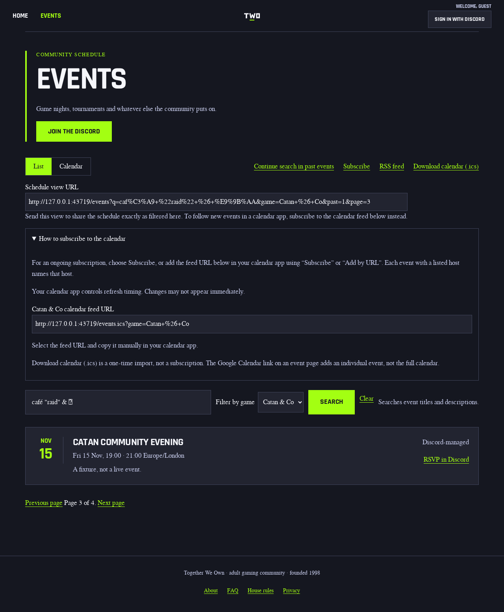
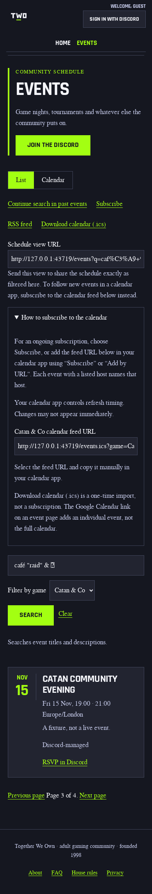

# Schedule view sharing — visual evidence

These are synthetic fixture events, not a live schedule. Captures come from the
committed browser acceptance (`e2e/schedule-sharing.spec.ts`): the real Hono
schedule renderer and the Kit adapter over the same shared screen, shipped
public styles and islands, and Chromium with only the clipboard and fixture
transport boundaries controlled. Before captures are the same spec's native
screenshots at the base revision; after captures are the same points with this
change. No staging or production probe was used.

## Design contract

- **Audience/job:** members and guests reading a filtered schedule who want to
  send someone the same view. The primary new action is
  **Copy this schedule view**; subscribing to the calendar feed stays a
  separate, separately labelled action directly below.
- **Content:** the absolute committed schedule URL (configured public origin
  plus the existing normalized calendar URL), a labelled readonly field that
  stays selectable without JavaScript, bounded clipboard feedback in the
  control's own live status, and one sentence distinguishing sharing this view
  from subscribing.
- **Continuity references:** the existing schedule controls and view toggle
  (`src/events/pages-calendar-controls.tsx`), the subscription-help disclosure
  with its feed field and copy button (`src/events/subscription-help.tsx`),
  and the event-page copy-link interaction. The block reuses the
  subscription-copy flex row, button, typography and color tokens; no new
  stylesheet rules.
- **Layout:** the share block rides inside the existing swapped `head` zone,
  under the archive/subscribe/feed links, so only an admitted calendar
  snapshot can refresh the value. The field and button wrap at mobile width;
  the acceptance asserts no horizontal page overflow at either viewport.
- **States:** native/no-JavaScript (field selectable, button hidden until
  enhanced), copied (own status only), manual (clipboard denied, missing,
  throwing or past its deadline: honest select-and-copy guidance, never a
  copied claim), pending (no claim until the write confirms), and
  committed-only updates (draft, failed, invalid, superseded and history
  turns keep or restore the last admitted value).
- **Non-goals:** feed byte/visibility/refresh policy, native share sheets,
  storage, new endpoints or data reads, redesign, budget or threshold changes.

## Opened before/after captures

| Viewport          | Before                      | After                      |
| ----------------- | --------------------------- | -------------------------- |
| Desktop 1280×800  | [Before](before-desktop.png) | [After](after-desktop.png) |
| Mobile 390×844    | [Before](before-mobile.png)  | [After](after-mobile.png)  |





State captures at desktop width: [both controls copied](success-desktop.png)
(each status holds only its own result), [manual guidance after a denied
write](manual-desktop.png), and [pending with no claim yet](pending-desktop.png).
The same states are asserted, not only photographed, for both renderers in the
browser acceptance. These are review evidence, not replacements for the pinned
CI visual baselines; the `events` baseline change is accepted through the
visual-regression artifact flow on this pull request. No baseline mask, score
threshold or bundle ceiling was changed: the enlarged copy island was kept
inside its existing budget by sharing its feedback machinery across controls.

## Reproduction and scope

```sh
npx vitest run test/islands-copy-link.test.ts test/islands-copy-link-activation.test.ts test/copy-link-races.test.ts test/event-copy-link-fallback.test.ts test/kit-events-calendar-parity.test.ts
npx playwright test e2e/schedule-sharing.spec.ts
```

Observed locally: unit and SSR suites 80/80, browser acceptance 26/26 across
both renderers (native selection at both widths, independent view/feed
copying with native Enter and Space, denied/missing/throwing/hung and
out-of-order clipboard outcomes, draft/failed/superseded/history turns and
replaced-node ownership). `npm run a11y` passed 146/146 scenarios locally.
Lighthouse and the pinned visual comparison run on exact-head CI; the Hono
quality gates do not independently exercise the Kit route, which renders this
same shared screen.
