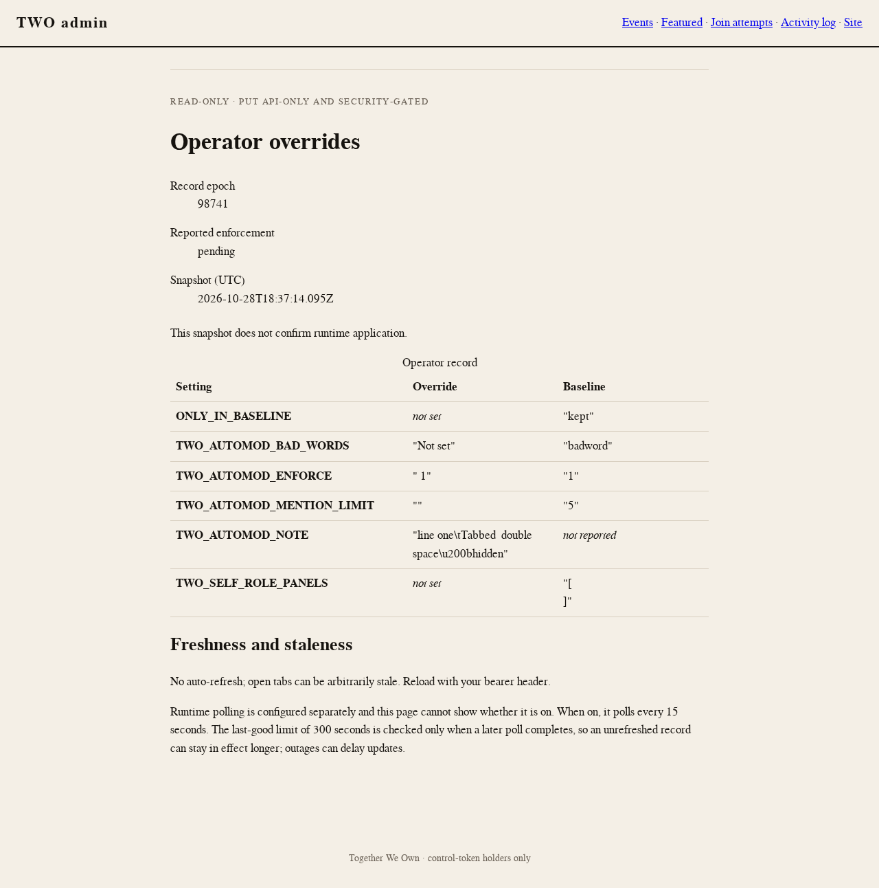
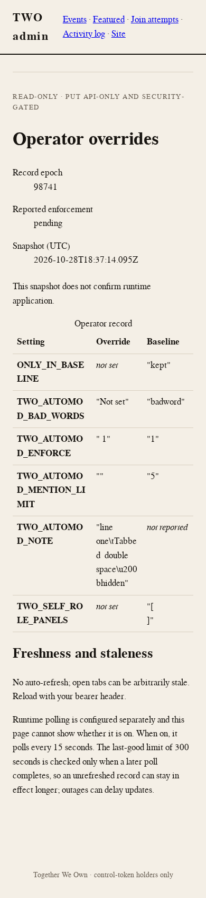

# Operator panel — populated record after the review fixes

Rendered from the real app (`app.request`) with a synthetic fixture record, served with the repository's `public/` assets, and captured at **1280×800 desktop** and **390×844 mobile**. Both images were opened and inspected. These are local fixtures, not staging or production records, and not pinned visual baselines.

The fixture exercises what the review asked the table to keep distinct:

- `TWO_AUTOMOD_ENFORCE`: override `" 1"` (leading space) beside baseline `"1"`.
- `TWO_AUTOMOD_BAD_WORDS`: the literal override `"Not set"`, quoted, beside the unquoted *not set* markers.
- `TWO_AUTOMOD_MENTION_LIMIT`: the empty override `""`.
- `TWO_AUTOMOD_NOTE`: a tab, a double space and a zero-width character, shown as `\t`, preserved spaces and `\u200b`.
- `TWO_SELF_ROLE_PANELS`: a 4,097-character baseline (`[` + 4,095 spaces + `]`), now accepted instead of hiding the record.
- `ONLY_IN_BASELINE` and `TWO_AUTOMOD_NOTE`: *not set* and *not reported* markers, one per column.

Measured in Chromium: no horizontal overflow at either width (`scrollWidth - clientWidth` = 0), and stored values compute `white-space: pre-wrap`. The 4,095 spaces wrap and hang at line ends, so the cell shows `"[` and `]"` on separate lines; the quotes make the whitespace's presence visible.

